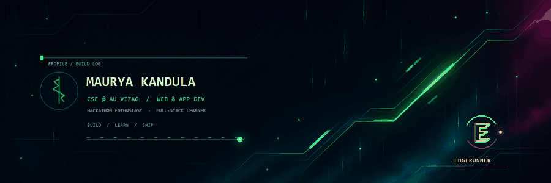
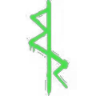

  

  
  &nbsp;&nbsp;
  

<h1 align="center">Kandula Paul Saketh Maurya</h1>

  <strong>Web & App Developer · CSE @ AU Vizag · Hackathon Builder</strong> 
  I turn prototypes into useful products and keep getting better by shipping.

  <code>Python</code> &nbsp; <code>PyQt6</code> &nbsp; <code>TypeScript</code> &nbsp;
  <code>React</code> &nbsp; <code>Express</code> &nbsp; <code>HTML / CSS</code> &nbsp; <code>SQLite</code>

---

## `01 / About`

- 🎓 Computer Science Engineering student at Andhra University, Vizag.
- 🛠️ Built 10+ app prototypes across web and desktop.
- ⚡ I enjoy hackathons, practical problem-solving, and polished user experiences.
- 📚 Currently sharpening full-stack skills by building and refining complete projects.

## `02 / Selected builds`

| Project | What it does | Stack |
|:--|:--|:--|
| [**CyberNotes**](https://github.com/MauryaKandula/cyber-notes) | Hardware-accelerated neon sticky notes for Windows, with rich text, freehand ink, and local SQLite storage. | Python · PyQt6 |
| [**ToolForge**](https://github.com/MauryaKandula/Web-dev/tree/main/ToolForge) | Five developer workflows for onboarding, DSA practice, resume tailoring, portfolio building, and freelance work. | TypeScript · React · Express |
| [**DuplicateCleaner**](https://github.com/MauryaKandula/DuplicateCleaner) | Finds byte-identical duplicate files with SHA-256 and previews recoverable space before deletion. | Python · Tkinter |
| [**MindMate**](https://github.com/MauryaKandula/MindMate) | A lightweight browser-based chatbot demo. | HTML |

## `03 / What I bring`

- Prototype quickly, then polish the details that make software comfortable to use.
- Work across web and desktop interfaces, with a growing full-stack toolkit.
- Communicate clearly, collaborate well, and learn fast in hands-on teams.

## `04 / Contact`

For roles, collaborations, or a quick hello: **[mauryakpsofficial@gmail.com](mailto:mauryakpsofficial@gmail.com)**

  Build at the edge. Learn by shipping.

