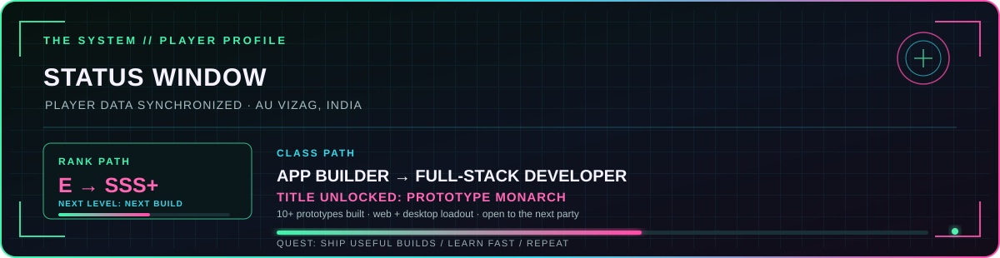
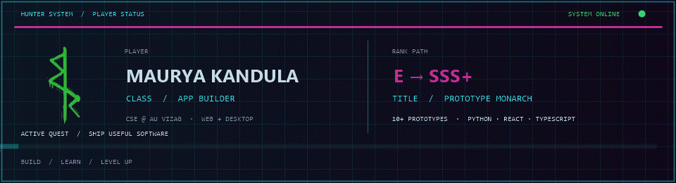

  

  

  <code>START SCREEN: ONLINE</code> &nbsp;•&nbsp;
  <code>AU VIZAG, INDIA</code> &nbsp;•&nbsp;
  <code>OPEN TO INTERNSHIPS</code>

<h1 align="center">KANDULA PAUL SAKETH MAURYA</h1>

  <strong>Web &amp; App Developer · CSE @ AU Vizag · Hackathon Builder</strong> 
  I turn rough ideas into useful web and desktop apps, then polish them until they feel right.

  <code>10+ PROTOTYPES</code> &nbsp;•&nbsp;
  <code>WEB + DESKTOP</code> &nbsp;•&nbsp;
  <code>BUILD → SHIP → LEVEL UP</code>

  <a href="#02--mission-select"><code>🕹️ MISSION SELECT</code></a> &nbsp;·&nbsp;
  <a href="#03--loadout"><code>🧰 LOADOUT</code></a> &nbsp;·&nbsp;
  <a href="#06--hunter-system--player-log"><code>⚔️ PLAYER LOG</code></a> &nbsp;·&nbsp;
  <a href="#05--party-finder"><code>📡 PARTY FINDER</code></a>

  
  
  
  
  
  
  

  

---

## 01 / PLAYER PROFILE

Computer Science Engineering student at Andhra University, Vizag. I like practical software: desktop tools, full-stack web apps, and the details that make both easier to use.

| PLAYER SIGNAL | CURRENT READOUT |
|:--|:--|
| **Build style** | Prototype quickly, listen closely, polish the experience |
| **Current focus** | More complete full-stack products with React, TypeScript, and Express |
| **Looking for** | Software internships, hackathons, and good teammates |

## 02 / MISSION SELECT

<table width="100%">
  <tr>
    <td width="50%" valign="top">
      <h3>⚡ 01 / CyberNotes</h3>
      
A hardware-accelerated Windows notes app with rich text, freehand ink, live links and tags, and local SQLite storage.

      
<code>PYTHON</code> <code>PYQT6</code> <code>SQLITE</code>

      <a href="https://github.com/MauryaKandula/cyber-notes">OPEN MISSION ↗</a>
    </td>
    <td width="50%" valign="top">
      <h3>🛠️ 02 / ToolForge</h3>
      
Five developer workflows for onboarding, DSA practice, resume tailoring, portfolio building, and freelance work.

      
<code>TYPESCRIPT</code> <code>REACT</code> <code>EXPRESS</code>

      <a href="https://github.com/MauryaKandula/Web-dev/tree/main/ToolForge">OPEN MISSION ↗</a>
    </td>
  </tr>
  <tr>
    <td width="50%" valign="top">
      <h3>🔎 03 / DuplicateCleaner</h3>
      
Finds byte-identical files with SHA-256 and previews recoverable space before deletion.

      
<code>PYTHON</code> <code>TKINTER</code>

      <a href="https://github.com/MauryaKandula/DuplicateCleaner">OPEN MISSION ↗</a>
    </td>
    <td width="50%" valign="top">
      <h3>💬 04 / MindMate</h3>
      
A lightweight browser-based chatbot demo built as a focused web prototype.

      
<code>HTML</code> <code>CSS</code> <code>JAVASCRIPT</code>

      <a href="https://github.com/MauryaKandula/MindMate">OPEN MISSION ↗</a>
    </td>
  </tr>
</table>

## 03 / LOADOUT

| BUILD TYPE | TOOLS |
|:--|:--|
| **Desktop apps** | Python · PyQt6 · SQLite |
| **Full-stack web** | TypeScript · React · Express |
| **Web foundations** | HTML · CSS · JavaScript |

### BUILD LOOP

  <code>FIND THE PROBLEM</code> &nbsp;→&nbsp;
  <code>SHIP A WORKING BUILD</code> &nbsp;→&nbsp;
  <code>POLISH THE DETAILS</code>

## 04 / ACTIVE QUESTS

  
<strong>Open the quest log</strong> · current objectives

   
  <ul>
    <li>Turn more prototypes into complete, reliable products.</li>
    <li>Keep leveling up full-stack skills with React, TypeScript, and Express.</li>
    <li>Join a strong team, ship useful work, and learn from the build.</li>
  </ul>
  
<code>SIDE QUEST: Make the interface feel as good as the feature.</code>

## 05 / PARTY FINDER

I’m open to **software internships, entry-level opportunities, hackathons, and collaborations**. If you’re building something useful, let’s talk.

  
  &nbsp;
  

## 06 / HUNTER SYSTEM / PLAYER LOG

  <code>RANK PATH: E → SSS+</code> &nbsp;•&nbsp;
  <code>TITLE UNLOCKED: PROTOTYPE MONARCH</code> &nbsp;•&nbsp;
  <code>CLASS: APP BUILDER</code>

  

  <code>QUEST ACCEPTED / BUILD SOMETHING PEOPLE WANT TO KEEP USING</code> 
  <code>BUILD AT THE EDGE / LEARN BY SHIPPING / REPEAT</code>

